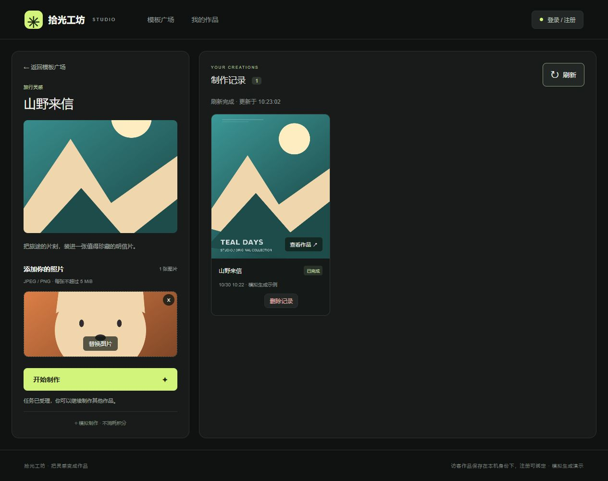

# v0.4 删除与刷新

2026-10-30，本地 Docker 环境。

- 已完成和失败记录提供“删除记录”按钮，确认后才调用接口；排队／运行中不能删除。失败时保留卡片并提供错误提示，操作中防重复点击。
- Java POST `/api/tasks/{id}/delete` 校验会话和归属，条件更新只允许 SUCCEEDED、FAILED。未登录 401、其他用户／不存在／已删除 404、未结束 409。
- Flyway V3 添加 deleted_at，逻辑删除后历史、详情、结果接口均不可见。不物理清理文件，不删除共享上传素材；目前没有回收站或恢复入口。
- 刷新为记录区域的数据刷新，保留上传选择和页面位置。显示转动图标、“刷新中”和完成时间；请求失败保留旧记录并提示。刷新成功回到最新第一页，服务器已移除的记录不再保留；分页可继续加载。
- 新建任务和轮询更新使用版本号合并，刷新期间的新作品不会因旧响应被覆盖。删除成功的记录也不会被同一轮迟到分页响应重新插入。

验证：前端 lint、typecheck、生产构建及 21 项测试通过，后端 13 项测试通过。新增 hook 测试覆盖刷新过程、成功替换、失败保留，以及删除成功／失败后的列表行为。真实 MySQL 脚本 `tests/deletion.mjs` 验证权限、终态限制、重复删除、详情和结果不可读、其他记录及共享素材保留，已加入 CI 配置（远程 CI 尚未执行）。

```sh
docker compose --profile test run --rm verify node /tests/deletion.mjs
```

浏览器在独立测试栈实际上传并制作作品，检查删除入口、确认弹窗及取消保留，点击刷新后更新时间变化。接口删除行为由独立脚本验证；未删除用户已有作品。测试环境完成后清理，日常预览数据库保留。


