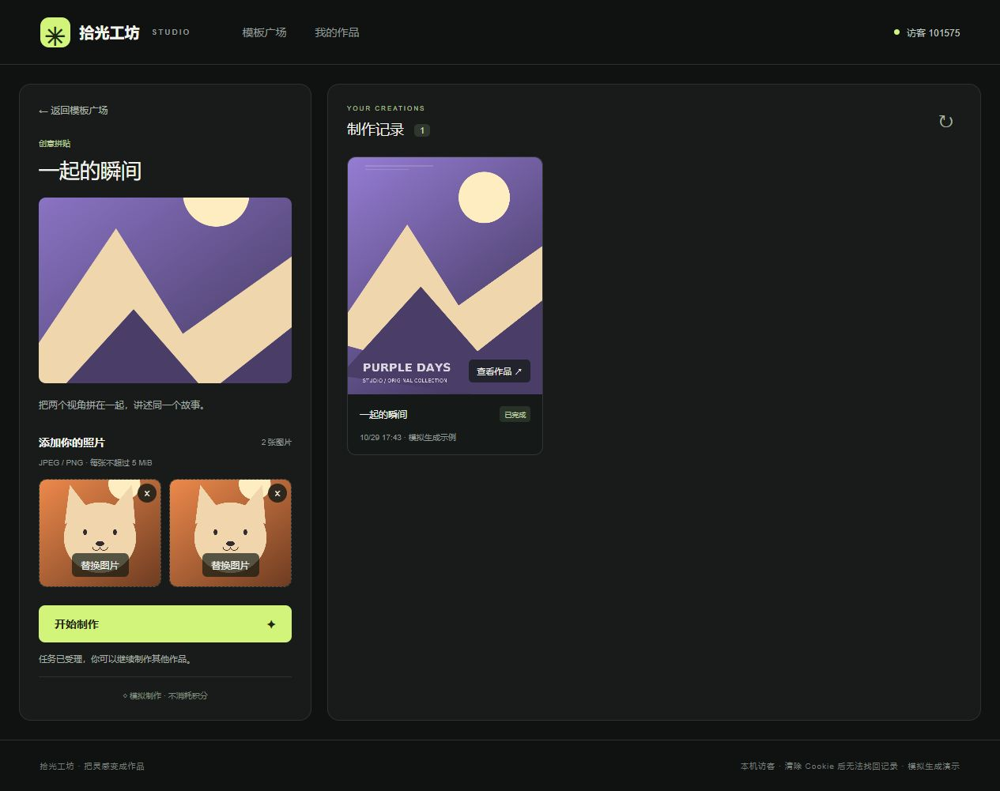
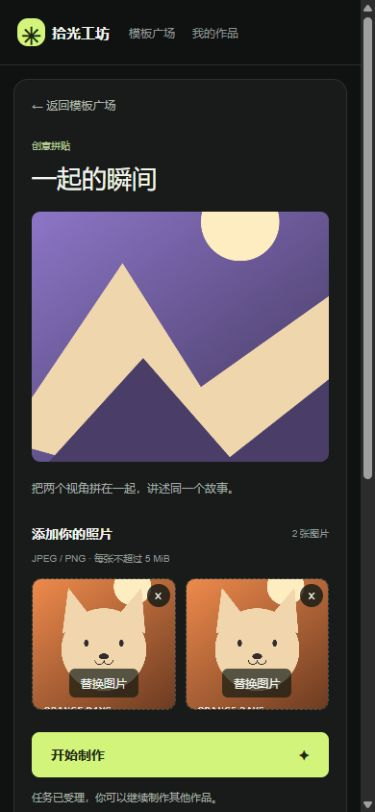

# v0.2：可靠性与交互验收

此文为 v0.2 历史记录。v0.3 已加入账户登录与访客绑定，最新说明见 [账户与记录验收](账户与记录验收.md)。

日期：2026-10-29（Asia/Shanghai）。在 v0.1 工程基础与业务闭环上继续开发，重点处理异步请求边界、文件校验及可重复的故障验收。

本轮可核实的新增源码记录始于 17:36，主要验证于 17:46 完成，约 10 分钟，另有此前代码检查及随后交付整理时间。第一轮约 20 分钟的记录单独保留，不把中间用户离线时间算作开发投入。

## 变更与原因

| 问题 | 修正 |
| --- | --- |
| 切换身份时旧数据可能闪现；旧分页异常可能污染新页面 | 列表、错误、请求统一绑定身份与模板范围；切换时立即隐藏旧列表；卸载中止请求并忽略迟到结果 |
| 多次点击加载更多可能发起重复请求 | 同步请求锁 + 按钮禁用；历史加载错误单独展示、可重试，不影响任务执行状态 |
| 上传替换／移除期间旧响应可能迟到 | 提取上传 Hook，用 AbortController 和上传位版本隔离；针对两个上传位编写回归测试 |
| 添加任务可能与正在进行的轮询重叠 | 在途标记确保同一范围只有一轮状态查询，完成后再安排下一次 |
| 分类刷新丢失 | 分类写入 URL，刷新恢复，并提供 aria-pressed |
| 图片无法加载时缺少反馈 | 封面、输入、结果统一使用可理解的图片异常占位；不改写成功任务状态 |
| 损坏图片可能触发不清楚的服务端错误 | 拒绝不可解码图片，返回 415；写文件异常时清理本次残留；对格式错误和未预期错误返回明确 JSON |
| 内部归属和文件路径出现在响应中 | 保留服务端使用，JSON 响应隐藏内部字段 |
| 队列满及服务重启仅有设计／代码，没有运行证据 | 独立 Compose 项目实际验证队列满和 SIGKILL 后重启；加入 CI |

## 实际结果

- 前端：ESLint、TypeScript、Next.js 生产构建通过；4 个测试文件共 **14 个测试通过**。
- 后端：Maven verify 通过；三个测试类共 **11 个测试通过**。
- 真实 API／MySQL：常规业务闭环、三个阶段失败、超大与损坏图片、未知路径／格式错误、个人隔离、结果和历史测试通过。
- 隔离故障注入：通过；临时项目 `creative-studio-boundary` 的容器、网络和数据卷已清理，预览站的数据库及文件卷保留。
- 浏览器：分类刷新恢复、双图上传、移除一个上传位后禁用提交、重新补齐后提交成功、图片结果展示、Enter 打开预览／Escape 关闭均通过。
- 390px 小屏：上下布局、无横向溢出；本轮成功保存可视区域截图。
- 当前预览地址为 http://localhost:3100 。三个服务健康检查通过。

远程 GitHub Actions 尚未执行；本地已执行其对应的构建、单元测试、接口及故障步骤。配置文件存在不等于远程运行记录存在。

## 故障测试证据与复现

独立测试项目使用一个线程和两个排队位置。先创建成功任务，再创建一个运行任务和两个排队任务；下一次提交立即记录 EXECUTOR_REJECTED，三个阶段全部 SKIPPED。随后只对独立项目的 Java 容器执行 SIGKILL，再启动同一项目：三个未完成任务均变为 FAILED / EXECUTION_INTERRUPTED，已成功任务及图片保持可读，之前的队列拒绝原因不被覆盖，active 查询为空。

在项目目录先运行 `docker compose build`，再依次执行：

```sh
docker compose -p creative-studio-boundary -f compose.yaml -f tests/boundary.compose.yaml up -d --no-build --wait --wait-timeout 180 db backend
docker compose -p creative-studio-boundary -f compose.yaml -f tests/boundary.compose.yaml --profile test run --rm --no-deps verify node /tests/boundaries.mjs prepare
docker compose -p creative-studio-boundary -f compose.yaml -f tests/boundary.compose.yaml kill -s SIGKILL backend
docker compose -p creative-studio-boundary -f compose.yaml -f tests/boundary.compose.yaml up -d --no-build --wait --wait-timeout 180 db backend
docker compose -p creative-studio-boundary -f compose.yaml -f tests/boundary.compose.yaml --profile test run --rm --no-deps verify node /tests/boundaries.mjs check
docker compose -p creative-studio-boundary -f compose.yaml -f tests/boundary.compose.yaml --profile test down -v
```

这些命令专门针对一次性故障测试项目，不应把项目名替换成预览或实际数据项目。测试 Cookie 只在隔离数据卷暂存，不输出到日志或源码包；清理步骤会删除该测试数据卷。

## R-01～R-14 对照

| 要求 | 实现及证据 | 当前结论 |
| --- | --- | --- |
| R-01 技术栈和职责 | Next.js / React / TS；Java / Spring Boot / MyBatis；真实 MySQL 和文件卷 | 已实现，容器构建与运行验证 |
| R-02 模板与分类 | Java 数据库种子六模板三分类、单图和双图 | 已实现，API 与浏览器验证 |
| R-03 上传与校验 | 上传位独立、替换／移除／错误、前后端数量／类型／大小检查 | 已实现，测试与浏览器验证；空态／不存在反馈具备 |
| R-04 异步受理 | 创建事务提交后调度；请求不等待生成；有界线程池 | 已实现，事务测试与真实 API 验证 |
| R-05 独立阶段与持久状态 | 三阶段数据库记录；只读查询；终态版本合并与条件更新 | 已实现，单元和集成验证 |
| R-06 可控失败和耗时 | 请求级开发覆盖，三个阶段可分别失败，每阶段统一耗时可调 | 已实现，三个失败边界运行验证 |
| R-07 前端状态／请求异常 | 上传、提交、排队、制作、结果与失败分开；网络错误保留快照 | 已实现，前端故障与恢复测试 |
| R-08 多任务生命周期 | 任务 ID 独立、只查未完成项、停止轮询、卸载／身份变化防过期响应 | 已实现，14 个前端测试中的相关用例验证 |
| R-09 刷新与历史 | MySQL 历史、active 恢复、分页、结果预览 | 已实现，接口和浏览器验证 |
| R-10 个人身份 | HttpOnly 随机访客 Cookie、令牌摘要、归属检查 | 已实现，双身份接口越权测试；不含找回或跨设备同步 |
| R-11 参考布局和可用性 | 深色列表、左制作右历史、上下小屏、标注和键盘预览 | 主要交互已验证；未覆盖所有设备及浏览器 |
| R-12 CI 与关键测试 | push/PR 配置、14 前端 + 11 后端测试、集成和故障验收 | 本地对应步骤通过，远程 CI 未运行 |
| R-13 交付说明 | 源码、锁文件、SQL／种子、README、模拟／身份／部署／回滚／AI说明 | 本地交付齐备；未创建远程仓库，无验收 commit |
| R-14 推荐容器交付 | Compose 一键启动三服务及初始化、健康检查、数据卷 | 已实现，新隔离数据库及服务启动已验证 |

## 验收截图

双图制作成功后的桌面页面：



390px 可视区域，包含两个上传位与制作按钮：



## 保留的边界

没有真实 AI、支付、任务重做、复杂账号体系、重启续跑或提交幂等。这些均为题目明确不要求或允许取舍的范围。服务中断后记录失败而非自动重试，是当前明确行为。

尚未进行磁盘满、数据库中断、大规模并发、所有键盘路径、真实手机和跨浏览器矩阵测试；匿名会话无法找回，历史页码分页在持续新增下可能重复项（前端去重），没有后台素材清理。完整限制仍见 README。

本轮 AI 工作流实例：先读轮询 Hook，发现分页错误不校验页面生命周期；改为统一范围状态与共享取消信号，再加入“旧分页请求失败不污染新身份”和“重复点击分页只请求一次”的测试，最后在容器运行所有前端检查。测试通过后进行真实浏览器双图制作，再整理本记录。
