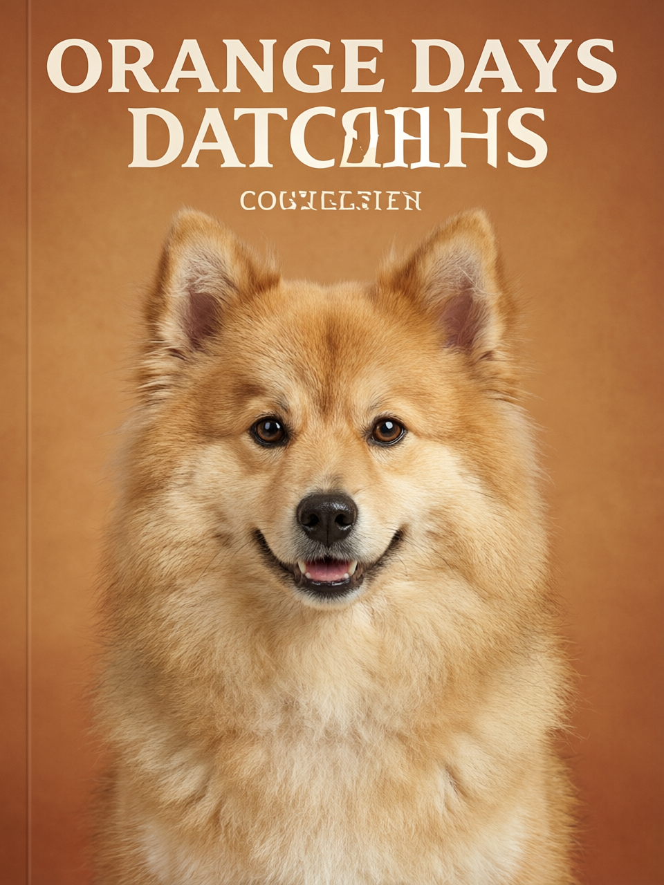

# v0.5 百炼图片生成

2026-10-30，使用百炼原生图像编辑接口，默认模型 `qwen-image-2.0-pro`。支持每个模板的一／两张参考图与固定风格提示词，单次输出一张 960×1280 图片。官方依据：[千问图像编辑 API](https://help.aliyun.com/zh/model-studio/qwen-image-edit-api)。

## 配置与启动

本轮检查发现 Windows 系统级 `DASHSCOPE_API_KEY` 非空，当前工具进程未继承该变量。只输出配置是否存在，没有输出值，也没有将实际密钥写入源码、日志或文件。`start.ps1` 按进程、用户、系统的顺序查找变量，以子进程环境传入 Docker Compose，仅 Java 服务获得 Key。

```powershell
# 在项目目录启动；第一次或改源码后加 -Build
./start.ps1 -Build
# 已有镜像时
./start.ps1
# 即使系统中存在 Key，也可显式运行本地模拟
./start.ps1 -Simulation
```

配置约定：

| 变量 | 默认／含义 |
| --- | --- |
| DASHSCOPE_API_KEY | 空时模拟，非空时真实调用 |
| DASHSCOPE_IMAGE_MODEL | qwen-image-2.0-pro |
| DASHSCOPE_BASE_URL | https://dashscope.aliyuncs.com/api/v1，北京地域 |

如果把之前文本模型使用的 `https://dashscope.aliyuncs.com/compatible-mode/v1` 配置为 BASE_URL，后端会规范化为 `/api/v1`，再调用 `/services/aigc/multimodal-generation/generation`。新加坡应使用相匹配的国际地域 Key 和域名。支持官方业务空间 `*.maas.aliyuncs.com` HTTPS 域名，不接受第三方代理域名。

普通 `docker compose up` 读取当前终端环境和本地 `.env`，不会主动读取 Windows 注册表中更新后的系统变量。因此 Windows 当前场景优先使用启动脚本。不要运行会把容器环境完整打印出来的命令。实际 Key 不要放在 `NEXT_PUBLIC_*` 中，也不要提交 `.env`。

## 两种策略和数据流

1. Key 缺失／空白：创建 SIMULATION 任务，使用本地程序绘制封面；不访问外部服务。
2. Key 非空：创建 BAILIAN 任务，保存当前模型名称。Java 将已校验的图片转换成 Base64，连同模板提示词发送到百炼。

任务仍为 CHECK_ASSETS → GENERATE → PACKAGE_RESULT。GENERATE 阶段进行同步远程调用，但运行在后台线程，HTTP 创建接口仍立即返回任务。生成的临时下载链接只由后端读取，结果转存本地 PNG，最终通过原有归属鉴权接口提供。不会把 API Key 带到结果下载请求中。

结果下载限制为官方 OSS HTTPS 域名，不跟随重定向，最多 20 MiB、2500 万像素。API 响应最多 1 MiB；模型请求约 240 秒、图片下载约 60 秒超时。请求失败不自动重试，避免未知受理状态导致重复计费。超时后应先检查百炼调用记录。

401／403／额度／限流／无效模型／服务异常／网络超时均记录为 FAILED，并返回脱敏错误；不回退成模拟成功。生产日志不记录上游原始错误体、签名 URL 或密钥。真实模式不接受开发模拟故障参数。

Flyway V4 为任务增加 generation_mode、generation_model。旧任务默认 SIMULATION，新任务保存实际来源，所以切换环境配置不会把旧模拟结果标成 AI 结果。制作页显示当前模式、模型、计费提示以及上传图会发送百炼的说明；作品和预览区区分百炼生成与模拟结果。模板广场封面仍是本地风格示意，并非生成结果承诺。

## 验收证据

- 前端 lint、typecheck、生产构建及 21 个测试通过；后端 Maven verify、19 个测试通过。
- 新增 6 个模型适配测试：空白 Key 不联网、双参考图请求和本地存图、下载不携带鉴权头、兼容地址转换、鉴权错误不伪装成功且不泄露上游消息、拒绝私网结果 URL／非官方 API 地址、限制响应体。（其中部分行为在同一测试中验证。）
- 独立测试栈明确覆盖为空 Key，完整模拟制作接口验收通过。接口 `/api/generation/config` 在主环境返回 BAILIAN，在独立空 Key 环境返回 SIMULATION。
- 用项目程序生成的宠物示意图实际调用一次 `qwen-image-2.0-pro`，任务 `7f97f50b-8c09-4b6b-b9cf-3aa42168f97b` 成功，返回 PNG 2,512,979 字节，已通过结果接口读取并保存。未使用用户的私人上传图片。
- 本轮真实调用只验收单张参考图；双图请求结构通过自动化测试，尚未额外发起双图付费调用。远程 CI 未执行。

真实调用验收脚本默认不会执行，需显式启用（会产生一次模型调用）：

```sh
docker compose --profile test run --rm --no-deps -e CONFIRM_REAL_GENERATION=yes verify node /tests/real-generation.mjs
```

日常无费用回归请使用 `tests/accounts.compose.yaml` 的独立测试栈，其中 Key 被显式覆盖为空；不要直接对已配置真实 Key 的主环境运行旧模拟故障脚本。



## 现有限制

模型输出具有随机性。本轮演示结果出现了参考图文字的延续和多余字符，即使提示词要求不加文字也不能保证完全遵循；参考图主体、文字和精确版式的保真需要后续专项调优。此处验证的是接口及持久化闭环，不代表所有模板的视觉质量验收。

执行队列仍为单实例内存队列，服务重启不续跑。正在调用外部服务时中断，服务端仍可能继续处理并计费；不自动重试。结果文件和已上传素材尚无自动清理。其他账户、删除和刷新能力沿用 v0.4。
