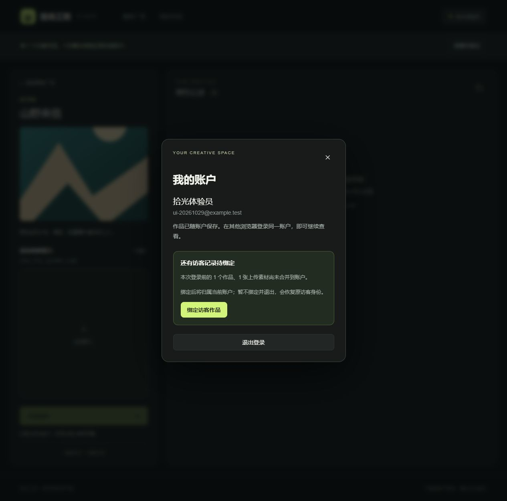
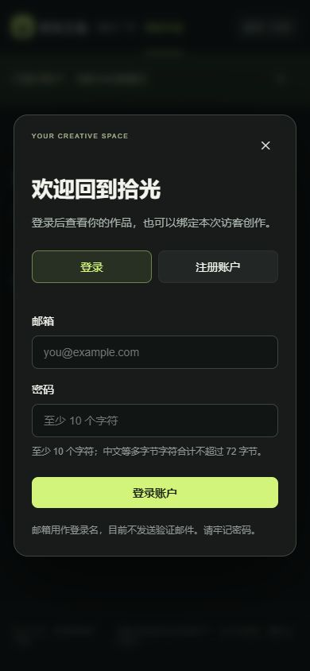
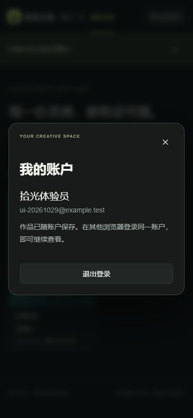

# v0.3 账户登录与访客记录绑定

2026-10-29，本地 Docker Desktop / Linux containers。此版本回应用户希望通过账户绑定个人记录的需求，扩展 R-10；原有异步制作逻辑保持可用。

## 用户可见行为

| 操作 | 结果 |
| --- | --- |
| 访客直接创作 | 仍可使用，不强制登录 |
| 昵称、邮箱、密码注册 | 升级当前身份，原访客作品及素材保留 |
| 登录已有账户 | 显示该账户的历史；访客记录单独等待绑定 |
| 查看并绑定 → 绑定访客作品 | 转移当前访客素材和任务归属，刷新个人历史 |
| 未绑定就退出 | 恢复登录前访客，不丢弃其作品 |
| 完成绑定后退出 | 创建新访客，账户作品不再显示 |
| 另一个浏览器登录同一账户 | 读取同一份个人历史 |
| 其他标签页切换身份 | 立即清空旧页面记录，重新加载当前身份 |

邮箱目前只是登录名，不发送验证邮件。密码至少 10 个字符、UTF-8 最多 72 字节，确认密码由前端校验，密码规则由前后端共同校验。没有提供邮箱验证或忘记密码。

## 数据与权限实现

Flyway V2 保留 V1 文件不变，将原 `visitor_session` 重命名为 `studio_owner`，把令牌摘要及有效期迁移到 `auth_session`，新增账户表。原 owner ID、外键、资产路径和旧 Cookie 均保留。已经从原数据库实际升级，并通过升级前创建的探针验证原 Cookie、上传素材、任务及成功结果仍可访问；也在空数据库验证了 V1 + V2 首次安装。

密码用 Spring Security Crypto 的 BCrypt 强度 12 编码，不保存明文。会话使用随机 32 字节令牌，数据库只存 SHA-256 摘要，Cookie 为 HttpOnly / SameSite=Lax，30 天有效。登录／注册轮换令牌，退出撤销当前令牌；POST 检查 Origin 和 Sec-Fetch-Site。其他已登录设备的会话不因当前设备退出而失效。

待绑定访客由服务端会话记录，接口不接受用户任意指定归属。绑定事务同时转移上传素材与任务，清除待绑定关联、撤销原访客会话并停用旧身份。正在生成的任务继续以原任务 ID 执行。上传落库和创建任务在事务内锁定有效 owner，防止绑定后的迟到请求写入废弃访客。账户状态变更在获取 owner 锁后重新锁定读取 session，避免 MySQL REPEATABLE READ 快照误接受并发请求中的旧令牌。

## 实际验证

- 前端 lint、TypeScript、生产构建全部通过，19 个 Vitest 测试通过。其中 5 个新测试覆盖密码确认、失败反馈与防重提交、显式绑定、本标签页通知、跨标签页旧记录清空。
- 后端 Maven verify 通过，13 个 JUnit 测试通过。新增退役访客迟到创建保护及 MyBatis 映射注册检查。
- 原有真实 MySQL 制作接口验收通过，包括六模板、图片校验、三阶段成功／失败、任务独立、归属隔离及终态稳定。
- 账户接口脚本通过：注册保留作品、重复邮箱、错误密码、大小写邮箱登录、跨浏览器身份恢复、显式绑定、未绑定退出恢复访客、退出后旧令牌失效、其他设备会话保留、跨账户素材及任务隔离、重复绑定、恶意来源、密码字节上限、绑定后结果可读。
- 同一个访客 Cookie 并发发起两次登录，只允许一次成功；另一次因旧令牌被撤销返回 401。
- 浏览器实际完成注册 → 退出 → 访客上传制作 → 登录 → 刷新保留待绑定提示 → 绑定 → 我的作品可见 → 退出后历史为空。
- 390 × 844 浏览器视口下，登录及账户窗口可操作，页面宽度 390，无横向溢出。未替代真实手机硬件测试。

实测修正了两处问题：MyBatis Mapper 重载方法导致映射冲突，改为独立方法名并增加注册测试；发送广播使用第二个 Channel 实例导致本标签页错误地收到自己的身份变更消息，改为复用监听实例并增加回归测试。

## 复现

日常验收（会创建独立的随机测试账户）：

```sh
docker compose build
docker compose up -d --wait --wait-timeout 180
docker compose --profile test run --rm verify
docker compose --profile test run --rm verify node /tests/accounts.mjs
```

如需不影响日常预览数据，可使用独立账户测试环境，先用上述 build 生成镜像：

```sh
docker compose -p creative-studio-accounts -f compose.yaml -f tests/accounts.compose.yaml up -d --no-build --wait --wait-timeout 180
docker compose -p creative-studio-accounts -f compose.yaml -f tests/accounts.compose.yaml --profile test run --rm verify node /tests/accounts.mjs
```

独立页面为 `http://127.0.0.1:3101`，与 `http://localhost:3100` 使用不同 Cookie 主机名和数据库卷。本轮 UI 验收使用此环境，完成后清理该测试栈。清理命令仅针对上述独立测试数据，不用于日常预览栈：

```sh
docker compose -p creative-studio-accounts -f compose.yaml -f tests/accounts.compose.yaml --profile test down -v
```

可选的 `tests/migration.mjs` 在 V1 上运行 prepare、升级 V2 后运行 check，需要私有临时目录挂载到 `/state`；探针包含测试 Cookie，校验成功会自行删除。不要把探针、数据库备份或真实凭据放入源码包。

CI 配置已加入账户脚本；本轮仅验证本地流程，未声称远程 GitHub Actions 已运行。原队列满／SIGKILL 故障注入证据保留在 v0.2 记录，本轮不重复故障注入。

## 界面证据







## 限制与投入

本地演示没有邮箱所有权验证、密码找回、登录限流、多因素认证或所有设备退出；也没有账户删除和数据清理。V2 数据库不兼容 v0.2 应用，回滚要配套恢复升级前备份，不能仅替换旧镜像，更不能删除日常数据卷。

本轮主要编码与验证可核实区间约 22:27–22:44（UTC+8），约 17 分钟，不包含此前分析和后续文档打包。由 Codex 辅助实现并通过上述工具检查，用户仍需理解并复核源码。所有截图账户与作品均为独立测试环境生成的演示数据。
