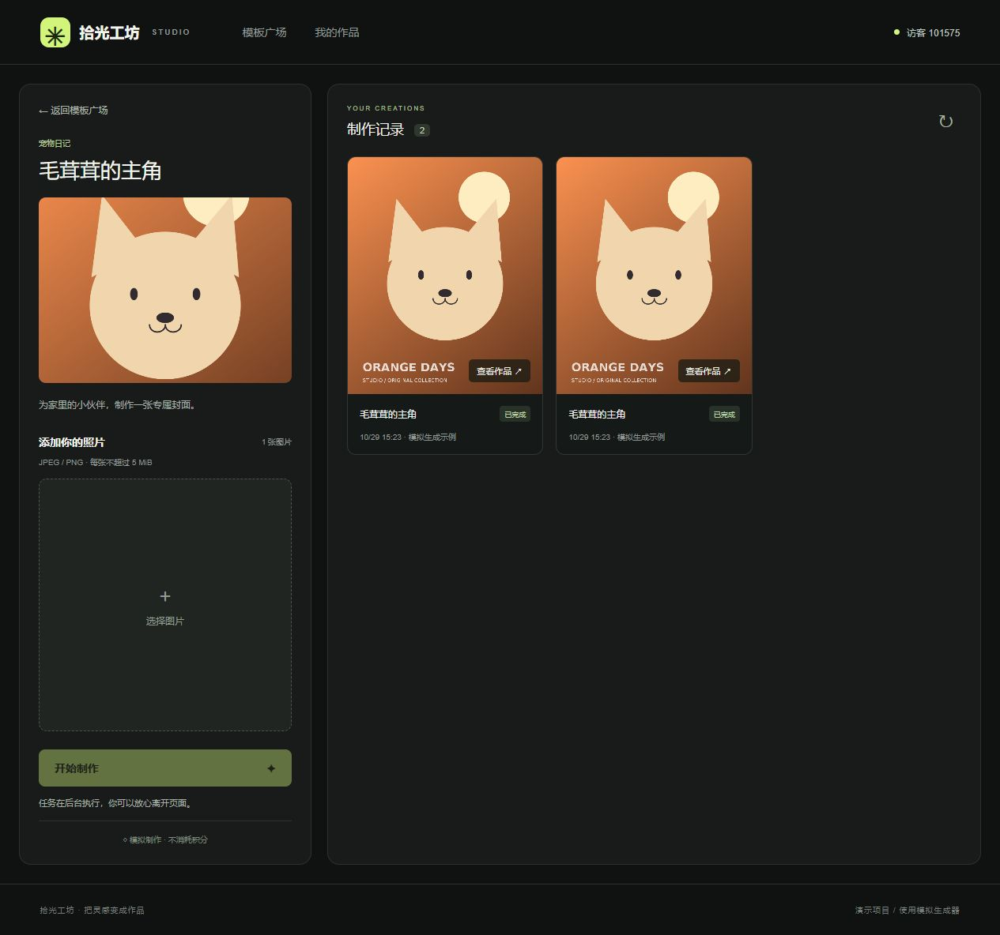

# 第一阶段开发与验证记录

> 历史记录：描述 v0.1。v0.2 的新增功能及最新验收状态请阅读同目录《可靠性验收.md》。

日期：2026-10-29（Asia/Shanghai）。本次交付目标为 M0 工程基础与 M1 最小业务闭环，同时实现了部分 M2 状态管理、M3 页面和 M4 交付基础，不宣称后续阶段全部完成。

本次可核实的编码记录从 15:08 首批文件写入开始，到约 15:28 最终构建及整理，约 20 分钟；不包含此前需求讨论和方案文档时间，也不代表用户本人的投入。开发由 Codex 工具辅助完成，未创建远程仓库或发布公网。

## 已实际执行

| 检查 | 结果 |
| --- | --- |
| Docker Compose 配置校验 | 通过 |
| MySQL 新数据卷启动、Flyway 建表和六模板种子 | 通过 |
| Java 21 / Spring Boot / MyBatis 容器编译与 Maven verify | 通过 |
| 后端阶段测试 | 4 个通过；正常顺序与三个阶段各自失败中断 |
| 前端 ESLint、TypeScript | 通过 |
| 前端 Vitest | 6 个通过；任务独立、终态稳定、查询故障恢复、轮询停止、旧身份响应丢弃、卸载清理 |
| Next.js 生产构建 | 通过 |
| npm 依赖检查 | 安装输出 found 0 vulnerabilities；不等于完整安全审计 |
| 容器服务启动 | MySQL、Java、Next.js 均 healthy |
| 真实服务接口集成 | 通过；成功任务、三个指定阶段失败、下游 SKIPPED、素材数量／格式校验、访客隔离、结果、历史、终态稳定 |
| 桌面浏览器页面 | 六模板、分类筛选、详情上传、两次提交、刷新恢复、成功结果均实际检查 |
| 图片预览 | 弹窗可打开；Escape 关闭且焦点返回预览按钮 |
| 小屏结构 | 390px 下 main 使用 block，上下布局，document scrollWidth=390，无横向溢出 |

前后端构建和执行都在 Docker 中完成。浏览器使用宿主机访问容器暴露的本地端口。接口脚本是项目内 `tests/api-smoke.mjs`，通过 Compose 的 test profile 执行。

## 浏览器证据

浏览器内使用项目自带图片上传，创建两个任务后刷新页面，仍能看到两个成功结果。截图位于同目录 `workspace-desktop.jpg`。截图中访客和任务属于本机演示数据。

小屏尺寸与 DOM 布局已检查，但浏览器工具两次未能捕获小屏截图，因此不把小屏视觉细节记为全面通过。没有进行真实手机设备测试。

## 具体修正记录

1. 初始测试工具版本出现 npm 安全告警，升级 Vitest 至 5.0.5；最终安装未报告已知漏洞。
2. ESLint 10 虽可运行，但 Next.js 部分插件 peer 声明尚未覆盖该版本，改为兼容的 9.39.5。该工具版本有停止支持提示，后续升级需同时核对 Next.js 插件兼容性；生产代码不依赖 ESLint 运行。
3. Maven `dependency:go-offline` 预取了大量本项目不使用的插件依赖；改为 Maven Central 镜像配置及带缓存的 `mvn verify`，新的首次后端构建约 98 秒，缓存后重建更快。
4. 任务状态使用服务端 version 合并，防止旧 RUNNING 覆盖新 SUCCEEDED；用可控迟到响应和假计时器验证。

## 仍未验收／后续工作

- 未在 GitHub Actions 远程运行；配置存在且本地执行了对应构建和接口步骤。
- 未做高并发、队列满、磁盘满、数据库中断、强制杀进程及大规模历史数据测试。
- 服务启动时收敛遗留任务的代码已实现，但未通过独立故障注入验证；不支持重启续跑。
- 未全面完成键盘操作、小屏视觉和所有异常页面人工检查。
- 首版几何插画与交互还有打磨空间；详细取舍与设计差异见 README。

源码可运行与全面满足最终交付验收是不同结论。当前 M0/M1 闭环已有运行证据，接下来优先补齐异常边界测试与页面细节，再按 R-01～R-14 逐项收尾。
